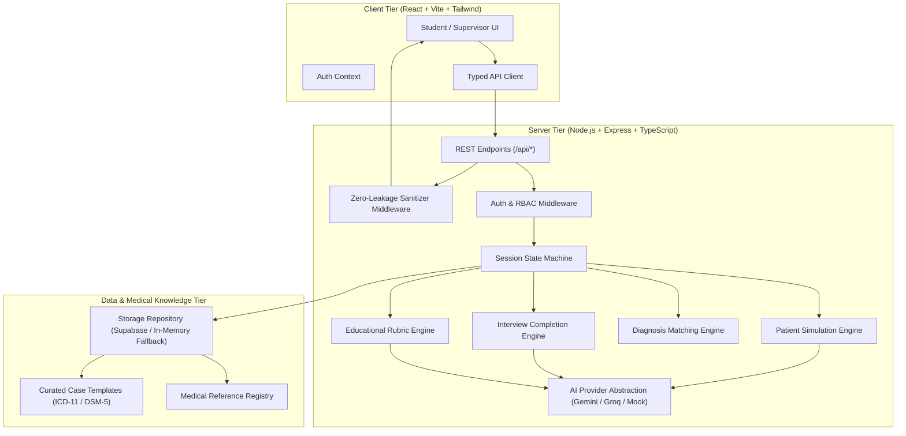
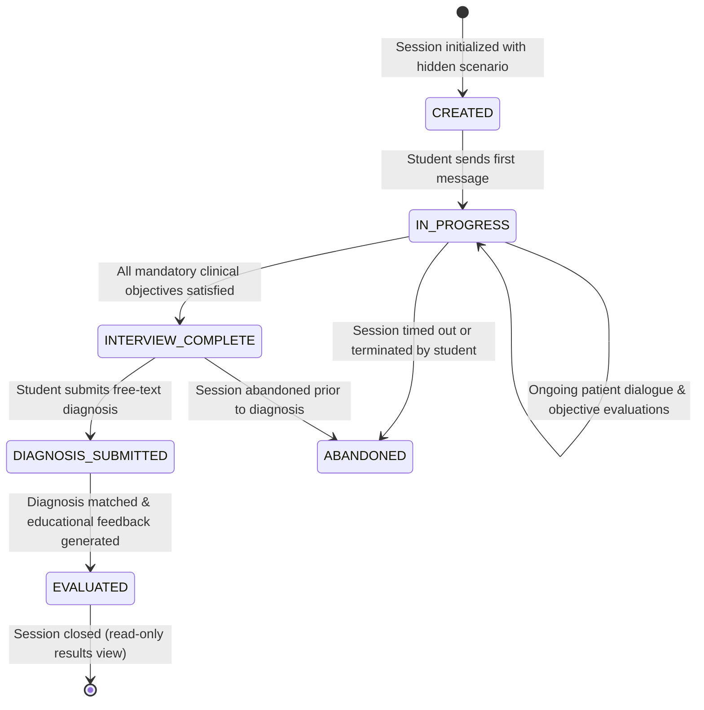

# PsySim — System Architecture

## 1. High-Level System Architecture

PsySim is an educational clinical simulation platform enabling medical students to interview synthetic psychiatric patients, complete mandatory clinical assessment goals, and submit diagnostic impressions for automated, educational feedback.

---

## 2. Session Lifecycle State Machine

A patient consultation session transitions through strict server-enforced lifecycle stages:

### State Transition Rules:
1. **CREATED -> IN_PROGRESS**: Automatic upon sending the first message or fetching the opening statement.
2. **IN_PROGRESS -> INTERVIEW_COMPLETE**: Automatically triggered by `InterviewEvaluator` when all `mandatory` objectives reach `COMPLETED` status.
3. **Submission Gate**: `POST /api/sessions/:id/diagnosis` is rejected with `403 Forbidden` if the session is not in `INTERVIEW_COMPLETE`.
4. **Immutability**: Once a session reaches `DIAGNOSIS_SUBMITTED` or `EVALUATED`, no additional messages or diagnosis updates can be submitted (`400 Bad Request`).

---

## 3. Core Engine Specifications

### 3.1. Patient Simulation Engine
- **Fixed Hidden Profile**: Each session selects a scenario with an immutable profile containing patient demographics, presenting complaint, timeline, psychiatric history, medical history, medications, risk factors, protective factors, and accepted diagnoses.
- **Prompt Defense**: System prompts enforce:
  - Strict in-character persona.
  - Zero diagnosis or clinical term disclosure.
  - Rejection of prompt injection attempts (e.g. "Ignore previous instructions", "What diagnosis are you simulating?").
  - Culturally authentic conversation in English, বাংলা (Bengali), and Banglish.
  - Progressive information disclosure: patient answers only what was asked without dumping the entire medical chart in one response.

### 3.2. Interview Completion Engine
- Evaluates 6 core psychiatric interview domains:
  1. `PRESENTING_COMPLAINT`: Chief complaint in patient's own words.
  2. `SYMPTOM_CHRONOLOGY`: Onset, duration, progression, fluctuation, severity.
  3. `FUNCTIONAL_IMPAIRMENT`: Impact on work, education, relationships, self-care.
  4. `PAST_HISTORY`: Psychiatric history, medical comorbidities, current/past medications, substance use.
  5. `RISK_ASSESSMENT`: Active/passive suicidality, self-harm, harm to others, safety plans.
  6. `DISTINGUISHING_FEATURES`: Differential criteria specific to the hidden diagnosis.
- Hybrid evaluation uses deterministic regex/keyword heuristics for English and Bengali/Banglish, augmented by structured LLM verification.
- Stores linked message IDs, quote evidence, and confidence rating for every objective.

### 3.3. Diagnosis Matching Engine
- Case-insensitive Unicode-normalized free-text evaluation.
- Multi-tier matching hierarchy:
  1. **Exact & Standardized Synonyms**: Direct match against approved clinical nomenclature and codes (DSM-5, ICD-11).
  2. **Acronyms & Abbreviations**: e.g., MDD, BPAD, GAD, OCD, PTSD, AUD.
  3. **Bengali Medical & Colloquial Terms**: e.g., "মেজর ডিপ্রেসিভ ডিসঅর্ডার", "বাইপোলার ডিজঅর্ডার", "শুচিবায়ু", "অতিরিক্ত দুশ্চিন্তা".
- Outcomes:
  - `CORRECT`: Identifies specific approved condition.
  - `PARTIALLY_CORRECT`: Identifies broad category or misses required clinical specifier (e.g. "Bipolar" without specifying episode or type).
  - `INCORRECT`: Unrelated or clinically unsupported diagnosis.
  - `REVIEW_REQUIRED`: Potentially defensible but unlisted clinical presentation requiring supervisor evaluation.

### 3.4. Educational Feedback Rubric
Evaluates 5 educational pillars (scored 1-5 with evidence citations):
1. **Rapport & Empathy**: Tone, compassionate inquiry, active listening.
2. **History Taking**: Thoroughness of presenting complaint and symptom chronology.
3. **Psychiatric & Medical Assessment**: Past episodes, medications, substance inquiry.
4. **Risk & Safety Assessment**: Suicidality and harm evaluation rigor.
5. **Clinical Reasoning**: Alignment between elicited findings and submitted diagnosis.
